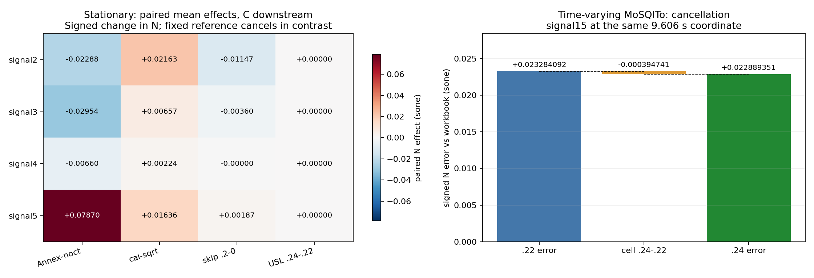

# F03 — multi-factor numerical matrix

Completed 2026-11-06T08:28:18.574688+08:00; product `118322f8300dc752f1d38a79db230a2db5ff2870`, repository HEAD `62e8559e8fe01350b9e07148784a6635d4522691`. Scope: **304 new evaluations** (256 stationary factorial + 8 crop controls + 40 TV cells), **24 verified reused TV cells**, plus reanalysis of **120 prior native TV output files** (overlapping those 24, not extra executions). All inputs are binary64 Pa. No product, DSP, formal-test, golden, old evidence, commit or push changes.

**The combinations show real cancellation and interaction; one coefficient change does not necessarily reduce the overall maximum error.** At Mo signal15/time9.606 s, the .22 signed error is +0.0232840920114 sone, and switching to .24 adds -0.00039474076824 sone, leaving +0.0228893512431 sone. Thus the .24 coefficient partly cancels a pre-existing positive residual. Returning to .22 removes that cancellation and raises this measured error. This comparison uses the **same input, implementation, timestamp and workbook reference**, not a subtraction of unrelated maxima.

## Stationary paired effects: C downstream, sone

| signal | Annex−noct | cal−sqrt | skip .2−0 | USL .24−.22 | largest pair interaction | DID (sone) |
|---|---|---|---|---|---|---|
| 2 | -0.0228833436061 | 0.0216286026111 | -0.0114714740701 | 0 | frontend_annex_minus_noct × skip_0p2_minus_0 | -0.00271491349798 |
| 3 | -0.0295438574334 | 0.00657369390607 | -0.00359709248934 | 0 | frontend_annex_minus_noct × skip_0p2_minus_0 | -0.000443069715586 |
| 4 | -0.00659551125006 | 0.00224109151739 | -2.60258030071e-07 | 0 | frontend_annex_minus_noct × calibration_cal_minus_sqrt | -9.27540695717e-06 |
| 5 | 0.0786953423658 | 0.0163602082209 | 0.00186969725048 | 0 | frontend_annex_minus_noct × skip_0p2_minus_0 | 0.000128497598737 |

## Same-window combination errors versus workbook

Fixed: post-filter skip=.2 s, C downstream, USL=.22. Values are signed N errors in sone.

| signal | noct/sqrt | noct/cal | Annex/sqrt | Annex/cal |
|---|---|---|---|---|
| 2 | 0.0242351629973 | 0.0458699080579 | 1.24125585792e-05 | 0.0216110577863 |
| 3 | 0.0297044285095 | 0.0362962913159 | -3.79574609246e-05 | 0.00650789270384 |
| 4 | 0.00657194530267 | 0.00881768466321 | -2.07816023599e-05 | 0.00221567959817 |
| 5 | -0.0786465399546 | -0.0623440082782 | 5.43889610789e-05 | 0.0164742451364 |

## Fixed-coordinate cancellation

| quantity at signal15, 9.606 s | sone |
|---|---|
| workbook reference | 8.6054 |
| Mo N022 | 8.62868409201 |
| Mo e022 | 0.0232840920114 |
| cell d=N024−N022 | -0.00039474076824 |
| Mo N024 | 8.62828935124 |
| Mo e024=e022+d | 0.0228893512431 |

## Calibration and rounding at that same coordinate

| calibration | USL | rounding | N at 9.606 s | error vs workbook |
|---|---|---|---|---|
| sqrt | 022 | mos-round | 8.62868409201 | 0.0232840920114 |
| sqrt | 022 | mos-noround | 8.62870861068 | 0.023308610678 |
| sqrt | 024 | mos-round | 8.62828935124 | 0.0228893512431 |
| sqrt | 024 | mos-noround | 8.62830649498 | 0.0229064949774 |
| cal | 022 | mos-round | 8.64362990194 | 0.0382299019383 |
| cal | 022 | mos-noround | 8.64354911097 | 0.0381491109715 |
| cal | 024 | mos-round | 8.64321369212 | 0.0378136921223 |
| cal | 024 | mos-noround | 8.6431532154 | 0.0377532154005 |

## Rounding isolation

| mode/control | maximum absolute N rounding effect (sone) | Nprime changed? |
|---|---|---|
| stationary, all 64 matched pairs | 0.000496436184988 | no; bitwise equal |
| TV representatives, all 16 matched pairs | 0.00138564967364 | no; bitwise equal |

## Crop/reset negative control

| signal | frontend | crop/reset − post-filter skip N (sone) | max specific-loudness difference (sone/Bark) |
|---|---|---|---|
| 2 | annex | 0.0131499678853 | 0.0204122840429 |
| 2 | noct | 0.01031242705 | 0.0173590891952 |
| 3 | annex | 0.00388896323059 | 0.00251296694728 |
| 3 | noct | 0.00343807378248 | 0.00230857293033 |
| 4 | annex | 2.16554559351e-06 | 2.2373591625e-05 |
| 4 | noct | -1.61678754473e-06 | 1.98103016624e-05 |
| 5 | annex | -0.00180633021394 | 0.00060905364669 |
| 5 | noct | -0.0017606772132 | 0.000609793954128 |

## Separate N and Nprime rankings: Mo original-rounding downstream

| signal | backend | criterion vs workbook | best cell | best error | worst cell | worst error |
|---|---|---|---|---|---|---|
| 2 | mos-round | N_max_abs | A-s2-annex-sqrt-w0.2-022-mos-round | 0.000499999999999 | A-s2-noct-cal-w0-024-mos-round | 0.0555 |
| 2 | mos-round | Nprime_max_abs | A-s2-annex-sqrt-w0.2-022-mos-round | 0.000148932517902 | A-s2-noct-cal-w0-024-mos-round | 0.0402972188164 |
| 3 | mos-round | N_max_abs | A-s3-annex-sqrt-w0.2-022-mos-round | 0.0002 | A-s3-noct-cal-w0-024-mos-round | 0.0398 |
| 3 | mos-round | Nprime_max_abs | A-s3-annex-sqrt-w0.2-022-mos-round | 6.10295967727e-05 | A-s3-noct-cal-w0-024-mos-round | 0.0154249558724 |
| 4 | mos-round | N_max_abs | A-s4-annex-sqrt-w0-022-mos-round | 0.0004 | A-s4-noct-cal-w0.2-024-mos-round | 0.0086 |
| 4 | mos-round | Nprime_max_abs | A-s4-annex-sqrt-w0.2-022-mos-round | 6.73989931003e-05 | A-s4-noct-cal-w0-024-mos-round | 0.0045947474333 |
| 5 | mos-round | N_max_abs | A-s5-annex-sqrt-w0.2-022-mos-round | 0.0002 | A-s5-noct-sqrt-w0-024-mos-round | 0.0808 |
| 5 | mos-round | Nprime_max_abs | A-s5-annex-cal-w0.2-022-mos-round | 0.00795869171399 | A-s5-noct-sqrt-w0-024-mos-round | 0.00995933241032 |

## TV representative matrix range

| signal | backend | min cell max \|N error\| vs workbook | max cell max \|N error\| vs workbook |
|---|---|---|---|
| 6 | c | 6.35010975039e-05 | 0.0251782538188 |
| 6 | sqat | 6.28611160227e-05 | 0.0251775934393 |
| 6 | mos-round | 0.000195185326763 | 0.0251845235957 |
| 6 | mos-noround | 6.28611163762e-05 | 0.0251775934395 |
| 15 | c | 5.85687643344e-05 | 0.0175312540611 |
| 15 | sqat | 5.81537627404e-05 | 0.017530915392 |
| 15 | mos-round | 0.0228893512431 | 0.0382299019383 |
| 15 | mos-noround | 0.0229064949774 | 0.0381491109715 |
| 16 | c | 8.05072623393e-05 | 0.0539599083699 |
| 16 | sqat | 7.92768520981e-05 | 0.0539578762941 |
| 16 | mos-round | 0.00314191024502 | 0.0543755556621 |
| 16 | mos-noround | 0.00347877732391 | 0.0539608136163 |
| 25 | c | 5.44609408131e-05 | 0.011324009636 |
| 25 | sqat | 5.43699413917e-05 | 0.0113233627269 |
| 25 | mos-round | 0.00059844064619 | 0.0112756139034 |
| 25 | mos-noround | 0.000640421573425 | 0.0113235098357 |

## TV calibration × USL interaction

Pointwise paired DID; maximum absolute magnitude over the four representative signals.

| backend | max \|calibration × USL DID\| N (sone) | signal | time (s) | max \|DID\| Nprime (sone/Bark) |
|---|---|---|---|---|
| c | 0.000144435930105 | 6 | 7.44 | 0.000282998380121 |
| sqat | 0.000144435958623 | 6 | 7.44 | 0.000282998380418 |
| mos-round | 0.000415469387029 | 16 | 0.116 | 0.0167232520585 |
| mos-noround | 0.000239240546627 | 15 | 4.926 | 0.0167232520585 |

## What the matrix establishes

- Under the registered stationary design, **USL has exactly zero effect in all 128 matched pairs**. The chosen steady signals do not exercise this table cell. This says nothing about other possible stationary spectra; the prior synthetic sensitive case already demonstrates nonzero slope-stage effects.
- Filter and calibration dominate different signals. For C downstream, signal2's average Annex−noct effect is −.0228833436061 sone and cal−sqrt is +.0216286026111; their signs oppose. Signal5's corresponding effects are +.0786953423658 and +.0163602082209, reinforcing in N. Fixed-cell errors in the second table show why an altered calibration may reduce a noct residual on one signal but worsen an Annex result already near the workbook. This is a diagnosis of reference agreement, not proof which calibration is physically authoritative.
- Window and frontend are not independent additive knobs. Signal2's frontend×post-filter-window **paired DID = −.00271491349798 sone**. The complete Walsh decompositions retain all higher orders: largest registered order≥3 N contrast among four-factor groups is 0.001 sone, and maximum full reconstruction residual is 7.1054273576e-15 sone. No high-order term is silently assumed zero.
- Main effect is the average matched high−low signed N difference; pairwise DID is average f11−f10−f01+f00. With ±1 coding, these equal 2×first-order and 4×second-order Walsh coefficients. Full coefficients and paired contrasts are separately labelled. Engine mode is categorical and contains multiple numerical decisions; differences between engine names are not interpreted as one isolated causal factor. No p-values or random-population claims are made.
- At signal15, .24 improves 596 workbook N coordinates, worsens 5110, and leaves 62 unchanged within 1e−12. The maximum-error coordinate favors .24 because of cancellation, while many other points favor .22. Detailed decomposition also distinguishes opposing-sign effects that overshoot, with full-grid Nprime against fixed C022 and available workbook Nprime trajectories separately reported.
- Removing Mo rounding preserves Nprime bitwise in all matched stationary and TV pairs. It does **not** eliminate the signal15 residual: the eight-cell fixed-coordinate table shows both increases and decreases in error. Rounding occurs after slope integration but before time weighting; its actual downstream effect is measured, not inferred from a .001/.01 nominal step.
- The two calibration factors are exactly 2sqrt(2) and .02/RMS(original calibration PCM)=2.835797716391444, a +.0226050990304 dB input-level change. The TV matrix has no stationary skip factor. At the shown signal15 coordinate, this calibration increase raises the residual by about .015 sone; it does not explain away the original roughly .023-sone discrepancy.
- Cropping before filtering is not equivalent to discarding the initial part of the already-filtered record. The negative-control table quantifies filter reset and (for noct) decimation effects. The primary matrix always filters the full input before post-filter RMS skipping.
- Best/worst ranks are separate for N and Nprime, within each signal/backend/reference. Rankings are limited to this finite grid, not recommended product settings. Tied best/worst cells may be multiple; tables show the first/last sorted representative, not a unique optimum. In particular, both USL values are equivalent throughout this stationary matrix. No conclusion is based on official-C-versus-itself zero; workbook comparisons and hybrid labels remain explicit.

## Native stages, controls and evidence boundaries

Mo noct is a **time-domain** decimate→Butterworth SOS→RMS frontend. The only audit adaptation adds post-filter RMS slicing. At skip0 all 28 levels match the original native API bitwise for all eight signal/calibration controls. Both frontends use the same post-filter time rule; no FFT surrogate is used. 32 primary level vectors feed three original implementations, with Mo no-round as a diagnostic mode. SQAT executes pinned v2.0 `.m` source directly in explicitly authorized GNU Octave 8.4.0; public method0 receives shared levels. Mo uses native main/slope stages; official C uses its native level API. These recombinations are **hybrid diagnoses**, not claims about unchanged public end-to-end behavior. B's native modes use original public time-domain pipelines; no-round is labelled diagnostic.

The first stationary harness attempt was correctly rejected by an exact-repeat assertion: official C's level API modifies its caller's level array. The adapter now supplies an independent copy and checks the shared input bytes after every call. The complete stationary experiment was rerun; original algorithms and repeat thresholds were not changed. The rejected log is retained. Skip0 parity, per-mode exact repeats, frozen-source isolation, input equality, full factor coverage, old-manifest integrity, time-grid checks and paired no-round Nprime controls are retained in machine-readable evidence.

C and SQAT returned timestamps must match their physical 2-ms grid; Mo's original endpoint-linspace labels are preserved and mapped by its fixed `[::24][::4]` source sample indices. Workbook time labels are asserted against the same grid. No fitted shift/interpolation is used. Extra tails are explicitly recorded. Nprime is 240 Bark bins at .1 Bark spacing; time/Bark coordinates accompany TV maxima. Workbooks contain full stationary Nprime profiles and only selected TV Bark trajectories for signals6–13; full-grid TV Nprime reference is C022, not an invented workbook matrix.

Relative errors exclude |reference|<1e−4 and count exclusions; where no denominator qualifies, relative error is null. RMS is over the stated coordinate set. Effects and errors use different reference meanings; zero-reference contrast summaries do not imply a meaningful relative percentage. Thresholds are numerical-control tolerances, not ISO conformity limits. Table A.9 authority remains unresolved. Results support diagnosis, not automatic DSP edits or standards claims.

## Reproducibility

See bilingual preregistration, `design-matrix.json`, `frozen-inputs.json`, `shared-levels.json`, `stationary-cell-results.json`, `paired-effects.json`, `full-walsh-decomposition.json`, `stationary-rankings.json`, `tv-cell-results.json`, `tv-paired-effects.json`, `all-tv-cancellation.json`, `all-tv-specific-cancellation.json`, `replay.md`, and `delivery-check.md`. Original SQAT commit, Mo source files, official-C binaries and all original-input hashes are frozen. Prior delivery hashes remain untouched. Large arrays/third-party files stay in the new scratch directory; only original scripts, metrics, reports and visual evidence are delivered. Delivery integrity hashes identify final redacted bytes, separately from raw source/input/output hashes.
