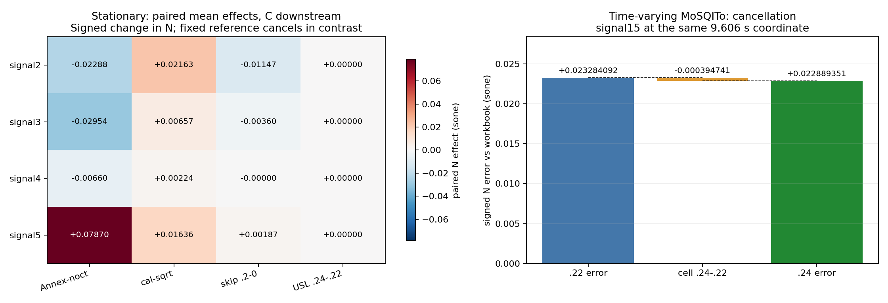

# F03 — 多因素組合數值矩陣

完成於 2026-11-06T08:28:18.574688+08:00；產品`118322f8300dc752f1d38a79db230a2db5ff2870`，repository HEAD `62e8559e8fe01350b9e07148784a6635d4522691`。**304個新運算格**（穩態256＋crop控制8＋TV40），另**24格已驗hash的TV引用**；再分析**120份舊原生TV輸出**（含上述24，不能當新增執行加總）。輸入全部binary64 Pa，未改產品/DSP/正式測試/golden/舊證據，未commit/push。

**排列組合確實出現誤差抵消與交互作用；改一格不保證整體最大誤差下降。** Mo第15號9.606秒，.22的signed誤差是+0.0232840920114 sone，切換.24加入-0.00039474076824 sone後剩+0.0228893512431。也就是.24局部抵消另一個既存正殘差；改回.22反而失去抵消，使該點測得誤差增加。這是在**同輸入、同實作、同時間、同工作簿參考**的配對結果，不是拿不同位置的max相減。

## 穩態配對效應：C下游，單位sone

| signal | Annex−noct | cal−sqrt | skip .2−0 | USL .24−.22 | largest pair interaction | DID (sone) |
|---|---|---|---|---|---|---|
| 2 | -0.0228833436061 | 0.0216286026111 | -0.0114714740701 | 0 | frontend_annex_minus_noct × skip_0p2_minus_0 | -0.00271491349798 |
| 3 | -0.0295438574334 | 0.00657369390607 | -0.00359709248934 | 0 | frontend_annex_minus_noct × skip_0p2_minus_0 | -0.000443069715586 |
| 4 | -0.00659551125006 | 0.00224109151739 | -2.60258030071e-07 | 0 | frontend_annex_minus_noct × calibration_cal_minus_sqrt | -9.27540695717e-06 |
| 5 | 0.0786953423658 | 0.0163602082209 | 0.00186969725048 | 0 | frontend_annex_minus_noct × skip_0p2_minus_0 | 0.000128497598737 |

## 相同window下的組合誤差：對工作簿

固定post-filter skip=.2秒、C下游、USL=.22；表值為signed N誤差，單位sone。

| signal | noct/sqrt | noct/cal | Annex/sqrt | Annex/cal |
|---|---|---|---|---|
| 2 | 0.0242351629973 | 0.0458699080579 | 1.24125585792e-05 | 0.0216110577863 |
| 3 | 0.0297044285095 | 0.0362962913159 | -3.79574609246e-05 | 0.00650789270384 |
| 4 | 0.00657194530267 | 0.00881768466321 | -2.07816023599e-05 | 0.00221567959817 |
| 5 | -0.0786465399546 | -0.0623440082782 | 5.43889610789e-05 | 0.0164742451364 |

## 固定座標的誤差抵消

| quantity at signal15, 9.606 s | sone |
|---|---|
| workbook reference | 8.6054 |
| Mo N022 | 8.62868409201 |
| Mo e022 | 0.0232840920114 |
| cell d=N024−N022 | -0.00039474076824 |
| Mo N024 | 8.62828935124 |
| Mo e024=e022+d | 0.0228893512431 |

## 相同座標的校準與rounding組合

| calibration | USL | rounding | N at 9.606 s | error vs workbook |
|---|---|---|---|---|
| sqrt | 022 | mos-round | 8.62868409201 | 0.0232840920114 |
| sqrt | 022 | mos-noround | 8.62870861068 | 0.023308610678 |
| sqrt | 024 | mos-round | 8.62828935124 | 0.0228893512431 |
| sqrt | 024 | mos-noround | 8.62830649498 | 0.0229064949774 |
| cal | 022 | mos-round | 8.64362990194 | 0.0382299019383 |
| cal | 022 | mos-noround | 8.64354911097 | 0.0381491109715 |
| cal | 024 | mos-round | 8.64321369212 | 0.0378136921223 |
| cal | 024 | mos-noround | 8.6431532154 | 0.0377532154005 |

## rounding隔離

| mode/control | maximum absolute N rounding effect (sone) | Nprime changed? |
|---|---|---|
| stationary, all 64 matched pairs | 0.000496436184988 | no; bitwise equal |
| TV representatives, all 16 matched pairs | 0.00138564967364 | no; bitwise equal |

## crop/reset負控制

| signal | frontend | crop/reset − post-filter skip N (sone) | max specific-loudness difference (sone/Bark) |
|---|---|---|---|
| 2 | annex | 0.0131499678853 | 0.0204122840429 |
| 2 | noct | 0.01031242705 | 0.0173590891952 |
| 3 | annex | 0.00388896323059 | 0.00251296694728 |
| 3 | noct | 0.00343807378248 | 0.00230857293033 |
| 4 | annex | 2.16554559351e-06 | 2.2373591625e-05 |
| 4 | noct | -1.61678754473e-06 | 1.98103016624e-05 |
| 5 | annex | -0.00180633021394 | 0.00060905364669 |
| 5 | noct | -0.0017606772132 | 0.000609793954128 |

## N與Nprime分開排名：Mo原始rounding下游

| signal | backend | criterion vs workbook | best cell | best error | worst cell | worst error |
|---|---|---|---|---|---|---|
| 2 | mos-round | N_max_abs | A-s2-annex-sqrt-w0.2-022-mos-round | 0.000499999999999 | A-s2-noct-cal-w0-024-mos-round | 0.0555 |
| 2 | mos-round | Nprime_max_abs | A-s2-annex-sqrt-w0.2-022-mos-round | 0.000148932517902 | A-s2-noct-cal-w0-024-mos-round | 0.0402972188164 |
| 3 | mos-round | N_max_abs | A-s3-annex-sqrt-w0.2-022-mos-round | 0.0002 | A-s3-noct-cal-w0-024-mos-round | 0.0398 |
| 3 | mos-round | Nprime_max_abs | A-s3-annex-sqrt-w0.2-022-mos-round | 6.10295967727e-05 | A-s3-noct-cal-w0-024-mos-round | 0.0154249558724 |
| 4 | mos-round | N_max_abs | A-s4-annex-sqrt-w0-022-mos-round | 0.0004 | A-s4-noct-cal-w0.2-024-mos-round | 0.0086 |
| 4 | mos-round | Nprime_max_abs | A-s4-annex-sqrt-w0.2-022-mos-round | 6.73989931003e-05 | A-s4-noct-cal-w0-024-mos-round | 0.0045947474333 |
| 5 | mos-round | N_max_abs | A-s5-annex-sqrt-w0.2-022-mos-round | 0.0002 | A-s5-noct-sqrt-w0-024-mos-round | 0.0808 |
| 5 | mos-round | Nprime_max_abs | A-s5-annex-cal-w0.2-022-mos-round | 0.00795869171399 | A-s5-noct-sqrt-w0-024-mos-round | 0.00995933241032 |

## TV代表矩陣範圍

| signal | backend | min cell max \|N error\| vs workbook | max cell max \|N error\| vs workbook |
|---|---|---|---|
| 6 | c | 6.35010975039e-05 | 0.0251782538188 |
| 6 | sqat | 6.28611160227e-05 | 0.0251775934393 |
| 6 | mos-round | 0.000195185326763 | 0.0251845235957 |
| 6 | mos-noround | 6.28611163762e-05 | 0.0251775934395 |
| 15 | c | 5.85687643344e-05 | 0.0175312540611 |
| 15 | sqat | 5.81537627404e-05 | 0.017530915392 |
| 15 | mos-round | 0.0228893512431 | 0.0382299019383 |
| 15 | mos-noround | 0.0229064949774 | 0.0381491109715 |
| 16 | c | 8.05072623393e-05 | 0.0539599083699 |
| 16 | sqat | 7.92768520981e-05 | 0.0539578762941 |
| 16 | mos-round | 0.00314191024502 | 0.0543755556621 |
| 16 | mos-noround | 0.00347877732391 | 0.0539608136163 |
| 25 | c | 5.44609408131e-05 | 0.011324009636 |
| 25 | sqat | 5.43699413917e-05 | 0.0113233627269 |
| 25 | mos-round | 0.00059844064619 | 0.0112756139034 |
| 25 | mos-noround | 0.000640421573425 | 0.0113235098357 |

## TV校準 × USL交互作用

逐點配對DID，表列四個代表訊號中最大絕對值。

| backend | max \|calibration × USL DID\| N (sone) | signal | time (s) | max \|DID\| Nprime (sone/Bark) |
|---|---|---|---|---|
| c | 0.000144435930105 | 6 | 7.44 | 0.000282998380121 |
| sqat | 0.000144435958623 | 6 | 7.44 | 0.000282998380418 |
| mos-round | 0.000415469387029 | 16 | 0.116 | 0.0167232520585 |
| mos-noround | 0.000239240546627 | 15 | 4.926 | 0.0167232520585 |

## 矩陣可以支持的判斷

- 本次穩態設計的**128組匹配USL前後差全部精確為0**：這些穩態測試訊號未走到該格，不代表所有可能穩態頻譜都不敏感；前輪人工敏感向量已證明slope stage可以有影響。
- 濾波與校準的主導程度依訊號而異。C下游的第2號平均Annex−noct為−.0228833436061 sone，cal−sqrt為+.0216286026111，符號相反；第5號則分別+.0786953423658、+.0163602082209，同向增加N。第二表固定格子的誤差顯示：某校準改動能讓noct殘差看似改善，卻使已接近工作簿的Annex結果變差。這是對參考值符合程度的診斷，不是判定哪種校準在物理上最權威。
- window與前端不能一律當成可直接相加的獨立旋鈕。第2號前端×post-filter window的 **paired DID=−.00271491349798 sone**。完整Walsh展開保留所有高階；四因子各組之中，三階以上N contrast的最大絕對值為0.001 sone，完整重建最大殘差7.1054273576e-15 sone，沒有偷偷假設高階為0。
- 主效應是其他設定相同的high−low signed N平均；二階DID是匹配的f11−f10−f01+f00平均。±1編碼下分別是Walsh一階係數的2倍、二階係數的4倍，機讀結果分欄。不同engine名稱包含多種數值決策，不把其差異當單一純因子；確定性實驗不報虛構p值或隨機母體推論。
- 第15號.24讓工作簿N的596個座標改善、5110個惡化、62個在1e−12內不變。最大誤差所在點因抵消而偏向.24，但許多其他點偏向.22。詳細分解另區分反向作用卻overshoot，完整240Bark Nprime對固定C022與工作簿可用軌跡也分開呈現。
- 取消Mo rounding，在所有匹配穩態/TV組的Nprime都逐位元不變；卻**無法消除第15號主要殘差**，固定座標8格顯示誤差有升有降。原rounding位於slope積分之後、時間加權之前，這裡量測其實際下游影響，沒有直接拿.001/.01取整步距當響度誤差。
- 校準因子精確為2sqrt(2)及.02/原始校準PCM RMS=2.835797716391444，輸入聲級提高.0226050990304 dB。TV矩陣沒有穩態skip因子；圖示第15號點提高校準後殘差增加約.015 sone，不能把原約.023 sone殘差解釋掉。
- 先crop再filter-reset，不等同濾完整段後才跳過前段RMS。負控制表直接量出reset與noct decimation相關差異；主矩陣一律先濾完整輸入再post-filter skip。
- N與Nprime最佳/最差分開排名，限同訊號/模式/參考及本有限網格，不是推薦產品設定。同值最佳/最差可能多組；表列排序首個/末個代表，不是唯一最優，尤其本穩態矩陣的兩種USL等效。不拿官方C對自身為0宣稱C勝出，工作簿與hybrid界線均明列。

## 原生stage、控制與證據邊界

Mo noct實際為**時域**decimate→Butterworth SOS→RMS，唯一audit改動是最後RMS取窗。skip0時8組訊號/校準的全部28帶都與原API逐位元一致；沒有FFT替代品。32個主矩陣聲級向量進三套原生下游，Mo no-round另標診斷模式。SQAT固定v2.0 `.m`直接在明確授權的GNU Octave8.4.0執行，method0收共同levels；Mo用原生main/slope stages，官方C用原level API。前後端互換是**hybrid診斷**，不是宣稱未改公開端到端行為。B的native模式走原本公開時間訊號pipeline，no-round仍明標診斷。

第一次A harness被exact-repeat正確攔下：官方C的level API會就地修改caller array。adapter已改每次獨立copy並逐次查共同輸入bytes不變，整個A完整重跑；沒有改原算法或放寬repeat門檻，拒絕log保留。skip0 parity、每模式repeat、source隔離、輸入相同、factor coverage、舊manifest完整性、格線及matched no-round Nprime控制皆有機讀證據。

C/SQAT原回傳時間必須符合物理2ms格線；Mo保留原endpoint-linspace標籤，依原碼`[::24][::4]`固定sample index映射。工作簿時間也assert同格線，未擬合位移或插值，額外尾端另列。Nprime為240個.1Bark格點，TV最大誤差附time/Bark；工作簿只有完整穩態profile及6–13號部分TV軌跡，完整TV矩陣參考是C022，不虛構工作簿資料。

相對誤差排除|reference|<1e−4並計數；完全無可用分母則null。RMS依各表格點集合；效應與誤差的參考意義不同，零reference的contrast摘要不能解讀有意義百分比。控制門檻不是ISO合格門檻；Table A.9權威仍未定，結論限診斷，不自動改DSP或宣稱標準全部通過。

## 重播與交付

見雙語預登記、`design-matrix.json`、`frozen-inputs.json`、`shared-levels.json`、`stationary-cell-results.json`、`paired-effects.json`、`full-walsh-decomposition.json`、`stationary-rankings.json`、`tv-cell-results.json`、`tv-paired-effects.json`、`all-tv-cancellation.json`、`all-tv-specific-cancellation.json`、`replay.md`、`delivery-check.md`。固定SQAT commit、Mo原碼、官方C binary與原始input hash，保留舊交付hash。大型陣列/第三方檔僅留新tmp，只交付原創script、指標、報告與圖。去識別後交付hash與原始source/input/output hash分開。
